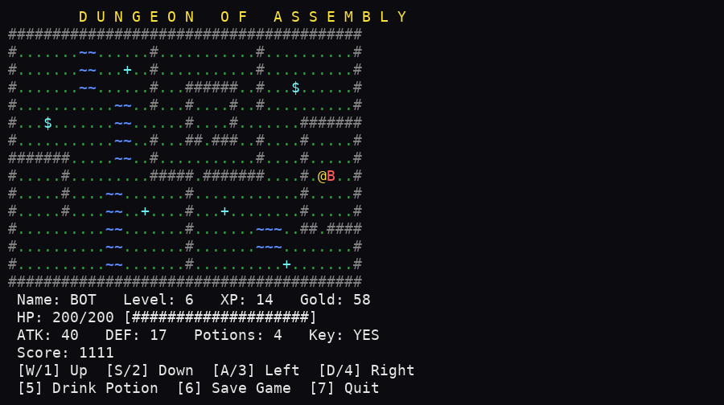

# Dungeon of Assembly

COAL lab project: a text-based dungeon RPG in **x86 Assembly (MASM, 32-bit)**
using the **Irvine32** library.

The whole map is printed on the screen and the player (`@`) moves with
W/A/S/D (or 1/2/3/4). Each step gives 1 point. Random enemies attack while you
walk, chests give gold, the shop sells potions and upgrades, and the key `K`
opens the boss room `B`. Kill the Dragon to win.

## Controls
| Key | Action |
|---|---|
| W or 1 | Move up |
| S or 2 | Move down |
| A or 3 | Move left |
| D or 4 | Move right |
| 5 | Drink potion (+30 HP) |
| 6 | Save game |
| 7 | Quit to main menu |

In battle: `1` Attack, `2` Drink Potion, `3` Run Away (50%; not possible against the Dragon).

## Map symbols
`@` player, `#` wall, `~` water, `.` ground, `C` chest, `$` shop,
`+` fountain (full heal), `K` key, `B` boss room.

## How to build
1. Open your Irvine32 Visual Studio project (`Project32_VS20xx`).
2. Add `DungeonRPG.asm` to the project (remove the sample `.asm`).
3. Build and run with **Ctrl+F5**.

Or, from the *x86 Native Tools Command Prompt*, run `build.bat`
(edit the `IRVINE` path inside if Irvine is not in `C:\Irvine`).

## Files the game creates
- `dungeon.sav`: saved game (4-byte header `DUNG` + player data + map)
- `highscore.txt`: the best score, stored as text

## Documents
- `docs/PROJECT_SUMMARY.md` / `.docx`: project description for the proposal
- `docs/INSTRUCTION_REFERENCE.md`: every instruction and function used, with definitions
- `docs/screenshots/`: screenshots of every screen
